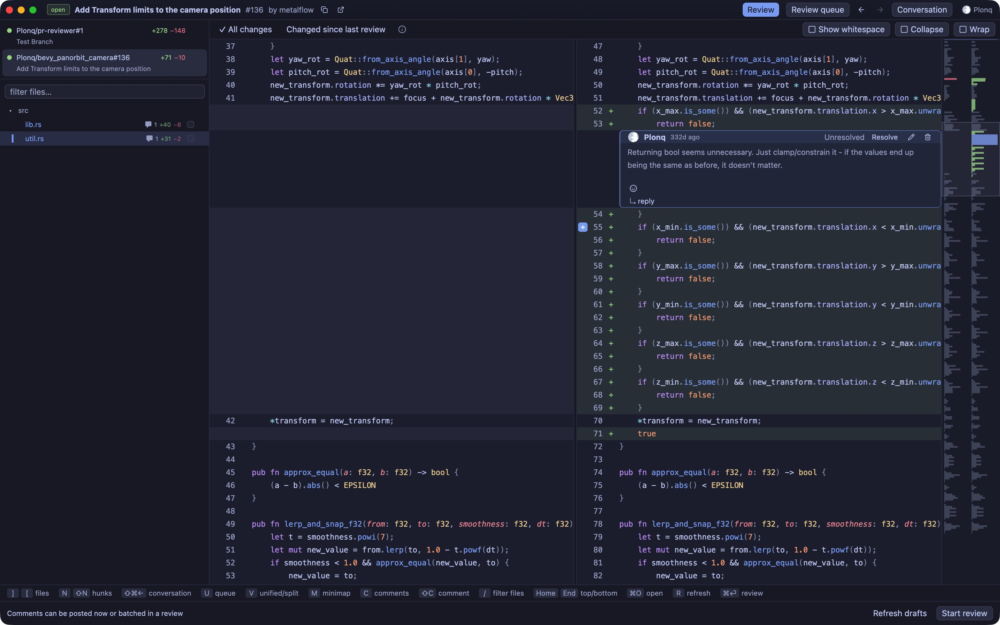

# Gander

A fast, native macOS app for reviewing GitHub pull requests.

Gander is personal software with a singular focus: provide the context you need to understand the PR and therefore perform a quality human review.

This came about out of frustration with GitHub's PR UI. Third party clients like the GitHub plugin in JetBrains' IDEs and the official one in VSCode also fell short in different ways. Gander addresses all these, and aims to provide all the good parts of GitHub's own interface, without the two big shortcomings: performance, and lack of context. I  designed this around those two things: fast navigation, and full file context.



## Features

### Pull Requests

- Uses your existing GitHub CLI (`gh`)
- Review queue, recently reviewed PRs, or open a PR directly with a link/ID
- View the PR description, timeline, conversation, commits, CI status
- Copy the PR link, open it in GitHub, submit review, review changes since your last review
- Mark files viewed/unviewed
- All the commenting features:
  - Multi-line
  - Top level and inline
  - Resolve/unresolve (resolved are collapsed by default)
  - Inline image, video, and mermaid, including opening media expanded (but not full screen!)
  - Reply, edit, and delete
  - Reactions
  - Comment on any line, not just within hunks
  - Preview comment rendering before submit

### Diffs

- Full files by default
- Show whitespace, toggle split/unified, hide unchanged lines
- Tree view for files, with fuzzy search
- Find keywords in the current file, all files, or only within the PRs diff, with minimap highlighting of matches
- Scroll locations are saved per-file, to allow easy switching without losing your place

### Other

- Most actions have a keyboard shortcut - moving between files & hunks, selecting lines and commenting, toggling diff options, etc
- Navigation history - go back through your own history (to quickly switch between two files, for example)
- Sessions are saved so quitting and re-opening will restore where you were before, including half-written comments, open files, and scroll positions

## Quick Start

Requires **Apple Silicon** and **macOS 15 or later**. GitHub reviews use your [GitHub CLI](https://cli.github.com/) login (`gh`); local diffs work without it.

### Install

1. Download [Gander.dmg](https://github.com/Plonq/gander/releases/latest/download/Gander.dmg) from the [latest release downloads](https://github.com/Plonq/gander/releases/latest).
2. Open the disk image and drag **Gander** into **Applications**.
3. Install the GitHub CLI if needed, then sign in:
   ```sh
    brew install gh
    gh auth login
   ```

Builds are **not notarised**. If macOS blocks Gander, attempt to open the installed
app, then choose **System Settings → Privacy & Security → Open Anyway**.
Installed builds check for updates on launch and hourly in the background;
**Gander → Check for Updates…** checks manually. **Restart to update**
installs a ready update and restores your review session. 

### Review your first PR

1. On first launch, open Gander to see your pending review requests.
2. Select a PR to read its conversation. Switch to **Changes** or click a file on the left to review the code.
3. Use **`[` / `]`** to move between files, **`n`** for the next hunk, and **`Shift+N`** for the previous hunk. Select a line or range and press **Shift+C** to comment.
4. Add comments to a pending review, then choose **Finish review** to approve, request changes, or submit a comment-only review.

**⌘O** opens a PR by URL or identifier, or a local repository by path. **`U`** returns to the queue without closing your open reviews.

### Build from source

With [Rust](https://rustup.rs/) and Xcode installed:

```sh
git clone https://github.com/Plonq/gander.git
cd gander
cargo run --release --locked
```

The repository pins the Rust toolchain and targets Apple Silicon. If the build reports a missing Metal toolchain, run `xcodebuild -downloadComponent MetalToolchain`.

To keep development settings, sessions, drafts and cached reviews separate from
the installed app, set `GANDER_DB_PATH`:

```sh
GANDER_DB_PATH="$PWD/target/dev-store.db" cargo run --locked
```

The database and its parent directories are created automatically. Without the
override, Gander uses `~/Library/Application Support/Gander/store.db`.

## Tech Stack

Built in [Rust](https://www.rust-lang.org/) with [GPUI](https://www.gpui.rs/) for the native UI. Uses `gh` for the GitHub API.

## Acknowledgements & License

Gander started as a fork of [ellie/lgtm](https://github.com/ellie/lgtm) and has since diverged significantly. Thanks to lgtm for the foundation!

Licensed under [MIT](LICENSE), including the original lgtm copyright notice.